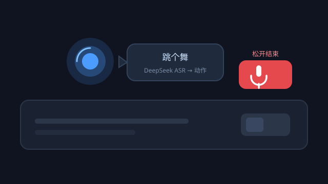

# Voice-controlled pet

Right-click the pet, choose **Voice control**, say one sentence, and the dsh-pet companion does it.

## Usage

1. Make sure **dsh-pet** is installed and enabled (the pet must actually be on your desktop).
2. **Right-click the pet**; **Voice control** is under **More** at the end of the menu.
3. Click it: the pet pops "I'm listening..." and records for **8 seconds**.
4. When you finish, your sentence becomes an action, and the pet shows a bubble telling you how it understood it.

Recording happens on the Host, so **the DSH web page does not need to be open** and no extra button has to be pressed.

## What it understands

| You say | The pet does |
| --- | --- |
| dance / maid dance / cute dance | plays that dance |
| go to sleep / good night | lies down to sleep |
| wake up | wakes up |
| go left / go right / come back | walks to that position |
| throw it / fling it | gets flung |
| eat rice / eat watermelon / hotpot / snacks | plays that eating animation |
| rubik's cube / pet the cat / fireworks / snowman / red envelope | plays that animation |

You can also say an **exact action name** ("solve a Rubik's cube in place", "hotpot"): the plugin matches keywords first, then falls back to a substring match against the configured animation names.

When nothing matches, the pet pops "didn't catch that" together with your words, so you can rephrase.

## Why recording happens on the Host

The pet lives in dsh-pet's desktop Electron window, which loads dsh-pet's own page; this plugin's code is not inside it. Browser recording needs a focused page, a user gesture, and microphone permission, and the right-click lands in the desktop window rather than the page.

Host-side recording sidesteps all of that: the menu click starts recording immediately, whether or not a page is open.

## Why Python

This machine's microphone reports **4-channel / 48000 Hz / 32-bit float** (`WAVE_FORMAT_EXTENSIBLE`). The legacy Windows `waveIn` interface only accepts integer PCM; negotiation "succeeds" but not a single sample arrives (measured: `dwBytesRecorded = 0`, `waveInGetPosition = 0`).

So the helper has to take WASAPI's native mix format and resample it to the 16 kHz / mono / PCM16 the ASR requires. Node has no ready-made Windows audio library, while Python can drive the COM interfaces through `ctypes` with **no third-party packages**.

## Which recognition path is used

The plugin sends the audio **directly** to DeepSeek's official ASR endpoint:

```
POST https://api.deepseek.com/v1/tools/asr
  multipart/form-data, the file field carries 16 kHz mono PCM16 WAV
→ { "request_id": "...", "text": "dance", "duration_ms": 2990 }
```

- Audio: 16-bit PCM WAV or Ogg Opus, mono or stereo (stereo uses the left channel), up to 120 seconds and 8 MiB;
- Authentication: the `DEEPSEEK_API_KEY` in DSH credentials, resolved per request through `ctx.credentials`;
- No dsh-pet relay and no DSH voice-input plugin required.

**The key is never cached, written to disk, or logged**; each recognition resolves it once and discards it.

Errors are reported by status code: 401/403 means an invalid key, 400 a bad audio format, 413 the recording is too large, 429 too many requests, 503/504 the service is busy.
## Configuration

| Key | Default | Meaning |
| --- | --- | --- |
| `pythonPath` | empty | Path to the Python interpreter. Empty means auto-detect (on Windows it tries `C:\python\python.exe` first, then `python` on PATH). |

## Limitations

- Requires **dsh-pet 0.4.9 or newer**: it provides `/menu/item` and the `/anim`, `/sleep`, `/position` action endpoints.
- Requires a configured `DEEPSEEK_API_KEY`; without it the pet reports that no key is configured.
- Requires **Python 3** on the machine (verified with 3.13).
- One recording is a fixed 8 seconds (the script accepts 0.5–120 s; change `RECORD_SECONDS`).
- Recognition is billed by audio duration on your DeepSeek account.
- It records the default capture device (WASAPI index 0).
