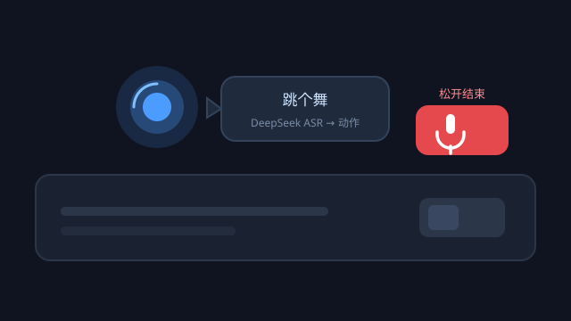

# 语音控制桌宠

按住对话输入框右侧的话筒说一句话，dsh-pet 桌宠就照着做。

## 怎么用

1. 确认 **dsh-pet** 已安装并启用（桌宠要真的在桌面上）。
2. 在 DSH 里打开任意一个会话，输入框工具栏右侧会出现一个话筒按钮。
3. **按住**话筒按钮说话，**松开**结束。
4. 识别出来的文字会显示在按钮的提示里，桌宠同时做出动作并弹一句气泡。

按一下不说话就松开不算数（少于 0.3 秒按误触丢弃）；麦克风没声音时会提示检查设备，不会白送一次识别。

## 会听懂什么

| 你说 | 桌宠做什么 |
| --- | --- |
| 跳个舞 / 女仆舞 / 宅舞 | 播对应舞蹈 |
| 睡吧 / 晚安 / 去睡 | 睡下 |
| 醒醒 / 起床 | 醒来 |
| 到左边 / 到右边 / 回来 | 走到对应位置 |
| 扔出去 / 甩出去 | 被甩飞 |
| 吃白饭 / 吃西瓜 / 涮火锅 / 吃零食 | 播对应吃东西动画 |
| 魔方 / 撸猫 / 放烟花 / 堆雪人 / 收红包 | 播对应动画 |

也可以直接说**动作的完整名字**（「原地专心玩魔方」「涮火锅」「悠闲哼歌」）——插件会先按关键词匹配，没命中再把整句话与配置里的动画名做包含匹配，所以说法宽一点也认得出来。

认不出来时桌宠会弹一句「没听懂」，并把原话一起带出来，方便你换个说法。

## 语音识别走哪条路

识别用的是 DeepSeek 官方语音识别接口 `POST https://api.deepseek.com/v1/tools/asr`，由 **dsh-pet 内置的实现**发起：

- 音频：16 kHz / 单声道 / 16 位 PCM 的 WAV，一次请求发完整段，返回完整转写文本；
- 鉴权：DSH 凭据里的 `DEEPSEEK_API_KEY`，由 dsh-pet 解析；
- 本插件只把音频 POST 给本机的 dsh-pet 路由 `/dsh-pet-7340/voice/hear`（`provider=deepseek`），只接收文字。

**本插件不读取、不保存、不转发任何 API Key。**

## 限制

- 需要 **dsh-pet 0.4.9 或更新**：`/voice/hear` 与 `deepseek` 识别实现是它提供的。更早的版本没有这条路由，按钮会报「识别请求失败」。
- 需要 `DEEPSEEK_API_KEY` 已配置，否则识别返回 `unsupported`，按钮提示「宿主没开语音识别」。
- 录音需要安全上下文：`https` 或 `localhost`。用局域网 IP 走 http 打开时浏览器不给麦克风。
- 单次说话上限 100 秒（官方 ASR 单请求上限 120 秒，留了余量）。
- 识别按音频时长计费，费用记在你的 DeepSeek 账号上。
- 说话要**按住**：这是按住说话，不是唤醒词，不会一直监听。
